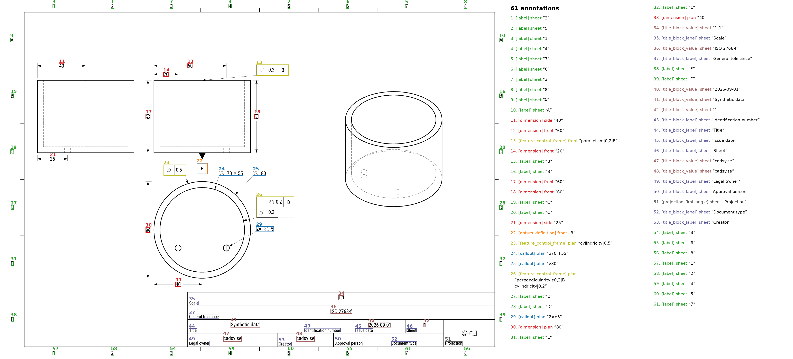

# CAD Technical Drawings, Generated by Cadsy

Turn a STEP model into a labeled technical drawing automatically.

This sample was created with **Cadsy** from 3D models in the
[Zero-to-CAD-100k dataset](https://huggingface.co/datasets/ADSKAILab/Zero-To-CAD-100k).
For every STEP model, Cadsy generated:

- one drawing using an ASME-style profile;
- one drawing using an ISO-style profile; and
- structured bounding-box labels for every retained annotation.

That is **65 CAD models, 130 technical drawings and their labels**, produced
through one repeatable generation pipeline.

## Example



An ISO-style drawing generated from a STEP model, with the annotation
boxes from its labels file drawn on top of the image.

## Build CAD drawing datasets without drawing every sheet by hand

Cadsy turns existing CAD geometry into consistent, machine-readable drawing
data. It can help teams create training sets, evaluation sets and
customer-specific datasets for systems that need to understand mechanical CAD
and technical drawings.

Use Cadsy to generate:

- paired STEP models and technical drawings;
- controlled ISO-style and ASME-style variants;
- annotation locations and text labels;
- repeatable datasets at a larger scale; and
- data tailored to particular part families or research tasks.

This repository is a public sample. To generate your own dataset with an API, visit **[cadsy.se](https://cadsy.se)**. 
To provide any feedback please wirte to **hello@cadsy.se**.

## Dataset contents

```text
metadata.jsonl
samples/
  part_0001/
    model.step          # source CAD geometry
    asme.png            # drawing generated with the ASME-style profile
    asme_labels.json    # annotations for asme.png
    iso.png             # drawing generated with the ISO-style profile
    iso_labels.json     # annotations for iso.png
  part_0002/
    ...
```

`metadata.jsonl` contains one line per part:

| Field | Type | Description |
|---|---|---|
| `part_id` | string | Part identifier, such as `"part_0001"` |
| `source_row` | int | Row index in the upstream Zero-to-CAD-100k dataset |
| `uuid` | string | UUID from the upstream row |
| `model_step` | string | Relative path to the STEP file |
| `asme_image` | string | Relative path to the ASME-style drawing |
| `asme_labels` | string | Relative path to the ASME-style drawing labels |
| `iso_image` | string | Relative path to the ISO-style drawing |
| `iso_labels` | string | Relative path to the ISO-style drawing labels |

Each `*_labels.json` file contains `{"annotations": [...]}`. Every annotation
has:

- `type` — `label`, `dimension`, `callout`, `feature_control_frame`,
  `datum_definition`, `title_block_value`, `title_block_label`, or
  `projection_third_angle`;
- `view` — `sheet`, `front`, `side`, or `plan`;
- `text` — the annotation text; and
- `box` — `[x0, y0, x1, y1]`, normalized to the 2480 × 1754 image.


## Important note

The ISO-style and ASME-style outputs are controlled synthetic generation
profiles. They are intended for dataset development and evaluation; they are
not certified manufacturing drawings or a substitute for engineering review.

## License

This sample dataset is released under Apache License 2.0. See `LICENSE`. See [Zero-to-CAD-100k dataset](https://huggingface.co/datasets/ADSKAILab/Zero-To-CAD-100k) 
for source license.
